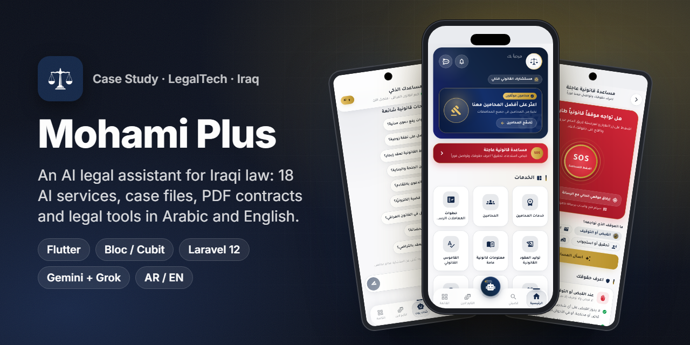
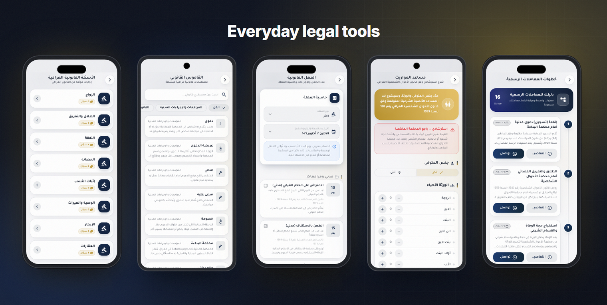
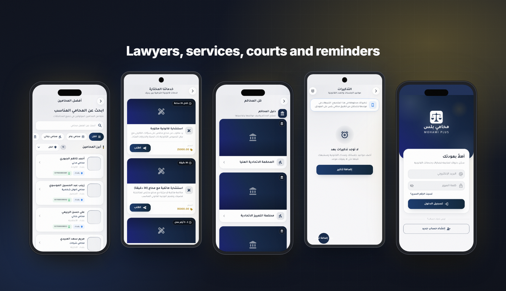
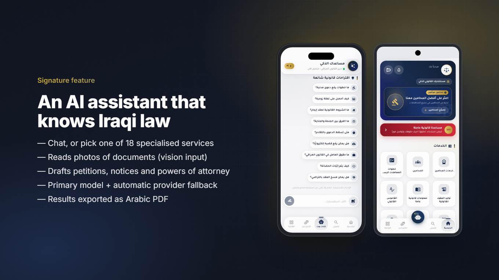
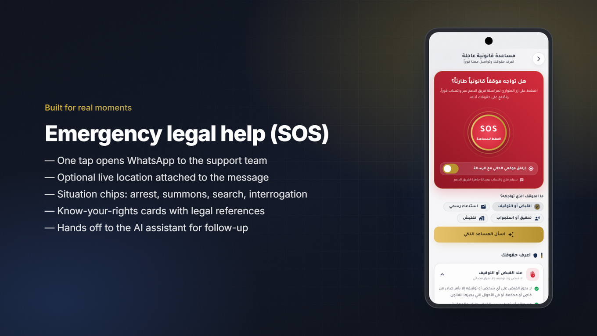
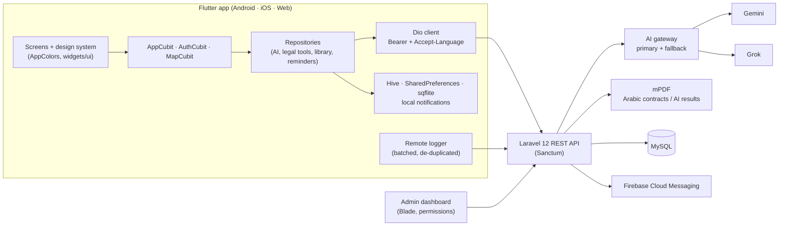

<h1 align="center">Mohami Plus (محامي بلس)</h1>

<b>An AI legal assistant for Iraq: ask a question, photograph a document, and get a formal Arabic petition or contract as a PDF.</b>

  
  
  
  
  
  
  

> ℹ️ This is a case study. The source code belongs to the client and is not included.

## Overview

**Mohami Plus** is a legal-services app for Iraq. It puts an AI legal assistant, lawyer search, case files, official contract templates and everyday legal tools into one Arabic and English app. It runs on Android, iOS and the web from a single Flutter codebase.

The product shares its engine with [LegalPal](https://github.com/ANaSHaker/legalpal-app-case-study), a sister app for lawyers in Palestine. Mohami Plus is the Iraqi product: Iraqi law, Iraqi courts and governorates, IQD pricing, its own navy-and-gold brand and a set of features LegalPal does not have.

**My role was the full delivery** of the October 2026 relaunch:

- the Flutter app: a premium redesign, a design system, Arabic and English, and light and dark modes
- new features: the AI services hub, emergency help, legal tools, reminders and the library
- the Laravel 12 backend, adapted to Iraq, with a new AI gateway and app-config API
- the admin dashboard redesign and the web build (see the [web case study](https://github.com/ANaSHaker/mohami-plus-web-case-study))

The app's package ID is `com.mohamiplus.app`. At the time of writing it was live on the web, and the store listings were marked "coming soon".

## The challenge

- **AI that writes like a lawyer.** An AI that "explains" is not enough. A lawsuit petition has to follow the structure required by the Iraqi Civil Procedure Law (No. 83 of 1969), with placeholders for missing facts and no made-up article numbers.
- **AI that keeps working.** Free tiers run out and providers go down. One provider was out of credits during the build, so a dead provider must never mean a dead feature.
- **A dated app that had to feel premium.** The app had about 70 screens with hard-coded colors and Arabic-only strings. All of them had to be redesigned for light and dark mode and translated, without breaking any flow.
- **Shared hosting.** The backend runs on cPanel shared hosting with no daemons, queue workers or socket server. Everything had to work synchronously, with timeouts.

## Highlights

**🤖 AI legal assistant**
- A chat assistant tuned for Iraqi law. It accepts photos of documents and remembers the conversation context.
- **18 specialised AI services**, managed from the dashboard:
  - consultation
  - lawsuit petition
  - contract drafting
  - contract review and risks
  - judicial notice
  - power of attorney
  - criminal complaint
  - appeal and defense memoranda
  - document reading and summary
  - legal translation
  - inheritance explainer
  - and more
- Results can be exported as a formatted Arabic PDF.

**📄 Contracts and documents**
- Official contract templates with fill-in fields. The server merges the values and returns a PDF with Arabic fonts (mPDF).
- Legal forms, legal clauses and step-by-step guides to official procedures.

**⚖️ Everyday legal tools**
- A legal dictionary of Iraqi terms, a legal-deadline calculator for appeal periods, an inheritance helper based on the Personal Status Law, government links and Iraqi legal Q&A.
- A library of Iraqi laws, court decisions and books.

**🆘 Emergency help**
- An SOS screen that opens WhatsApp to the support team, optionally with the user's live location.
- It also has situation chips and "know your rights" cards for arrest, summons, search and interrogation.

**🗂️ Practice management**
- Case files with sessions and updates, case search, a lawyer agenda, notes and **local reminders** for sessions and deadlines (scheduled notifications).
- A lawyer directory, paid legal services, a community timeline, support chat and subscriptions (ZainCash).

**🎨 Product quality**
- A design system with color tokens derived from the brand color, and a "Midnight Aurora" dark mode.
- Arabic and English with runtime RTL/LTR switching.
- Feature flags and app-update control from the server, plus remote error logging to the dashboard.

## Screens

Iraqi legal Q&amp;A, legal dictionary, deadline calculator, inheritance helper and official procedure guides.

Lawyer directory, paid legal services, court guide, reminders and sign-in.

> These are real screenshots of the app's own web build, rendered at phone size (390 × 844). The lawyer names and phone numbers in the directory are seeded demo data. Some lists show skeleton placeholders while live content loads.

## Signature feature: an AI assistant that knows Iraqi law

1. The user chats freely, or picks a service such as "Lawsuit petition". Each service has its own system prompt, which the admin can edit in the dashboard.
2. Text and up to four images go to `POST /ai/services/{slug}/run` on the backend. The app never holds an AI key.
3. The **AI gateway** tries the primary provider first. On 401/402/403/429/5xx errors, timeouts or "quota" messages, it falls through to the next enabled provider (Gemini or Grok). Every attempt is logged with latency for the dashboard.
4. The prompts force formal, structured Arabic output. For a petition, the output follows the statutory structure: court header, parties, facts, legal grounds, requests and signature lines. Missing details become `[....]` placeholders.
5. The result is shown as Markdown. One tap renders it as a PDF on the server.

Guests are rate-limited by IP. Signed-in users have a daily limit.

## Architecture & stack

| Layer | Technology |
|---|---|
| App | Flutter 3.41 / Dart 3, Material 3, Tajawal font |
| State | `flutter_bloc` (Cubits: App, Auth, Map) |
| Networking | Dio with an auth and locale interceptor, plus `AppConfig` build-time `--dart-define`s |
| Local data | Hive, SharedPreferences, sqflite; `flutter_local_notifications` + `timezone` for reminders |
| i18n | `easy_localization`, namespaced ASCII keys (`'lawsuits.title'.tr()`), runtime RTL/LTR |
| Firebase | Messaging, Crashlytics, Analytics, Performance, Remote Config, App Check |
| Other | `local_auth` (biometrics), `printing` + `pdf`, `cached_network_image`, `webview_flutter` |
| Backend | Laravel 12, PHP 8.3, MySQL, Sanctum, spatie/permission, mPDF, kreait/firebase |
| AI | A server-side gateway with Gemini and Grok providers and automatic fallback; keys are encrypted at rest |

## Engineering notes

- **Prompts as data, not code.** The 18 AI services live in an `ai_services` table: slug, bilingual titles, icon, color, category and system prompt. The app builds its AI hub from `GET /ai/services`, so a new service needs no app release.
- **Provider fallback.** The gateway sorts the enabled providers by priority. It treats auth, quota, rate-limit, server and timeout failures as "try the next provider". It records each attempt (provider, model, status, latency) for a usage dashboard. This mattered in practice: one provider had no credits, and a slow model once took 93 seconds, so the primary model was made editable in the dashboard.
- **Arabic PDFs on shared hosting.** Contract templates hold `##$$label##$$` placeholders. The server extracts them as form fields and escapes the user's input before merging. mPDF renders the result with bundled Arabic fonts, because some popular font families are not supported by mPDF.
- **A redesign without regressions.** A shared brief fixed the rules: keep every cubit call, route name and cache key, and only change visuals. All ~70 UI files moved to `context.colors` tokens and `widgets/ui` components. `flutter analyze` finished with 0 errors. Translation keys are ASCII namespaces, because dots inside Arabic sentences break nested lookups in `easy_localization`.
- **RTL and LTR from one layout.** Every `EdgeInsets.only(left/right)` became directional, every `Alignment.centerRight` became `AlignmentDirectional`, and directional icons mirror correctly. English is real LTR, not mirrored Arabic.
- **Observability.** A remote logger catches Flutter, platform, zone, network and bloc errors. It queues them locally, de-duplicates repeats within 60 seconds and sends them in batches of up to 50. It never logs headers, tokens or request bodies. The dashboard groups errors by fingerprint.

## Results

- Live on the web as a Flutter build at [mohami.plus](https://mohami.plus). At the time of writing, the landing page showed **18 AI services, 28 contract templates, 59 courts in the directory and 233 terms in the legal dictionary**, all read live from the API.
- The store listings (`com.mohamiplus.app`) were not public yet. The site marks Google Play and the App Store as "coming soon".
- The same engine also powers [LegalPal](https://github.com/ANaSHaker/legalpal-app-case-study), which is live on Google Play and the App Store in Palestine.

## بالعربي

**محامي بلس** تطبيق قانوني عراقي مدعوم بالذكاء الاصطناعي، يعمل على أندرويد وآيفون والويب من كود Flutter واحد.
يضم مساعدًا قانونيًا يفهم القانون العراقي ويقرأ صور المستندات، و18 خدمة ذكية لصياغة لوائح الدعوى والعقود والإنذارات والوكالات وتصديرها بصيغة PDF.
ويضم أيضًا أدوات يومية: القاموس القانوني، وحاسبة المهل، ومساعد المواريث، ودليل الإجراءات، والمساعدة القانونية العاجلة (SOS)، وتذكيرات الجلسات.
قمت بإعادة التصميم الكاملة (فاتح وداكن)، والترجمة العربية والإنجليزية، والباك إند (Laravel 12) مع بوابة ذكاء اصطناعي تنتقل تلقائيًا إلى مزوّد بديل، ولوحة التحكم.

## Links

- 🌐 Website: [mohami.plus](https://mohami.plus)
- 🖥️ Web app: [mohami.plus/home](https://mohami.plus/home/)
- 🧩 Related: [Mohami Plus web case study](https://github.com/ANaSHaker/mohami-plus-web-case-study) · [LegalPal app](https://github.com/ANaSHaker/legalpal-app-case-study)

---
<h3 align="center">Built by Mahmoud Shaker — Senior Flutter Engineer</h3>

  
  
  
  
  
  
  

